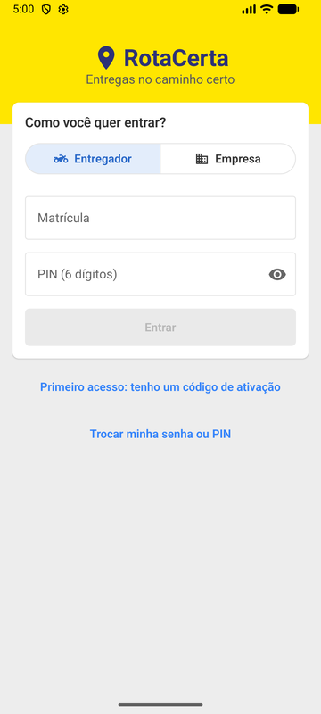
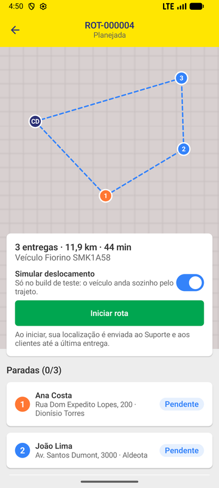
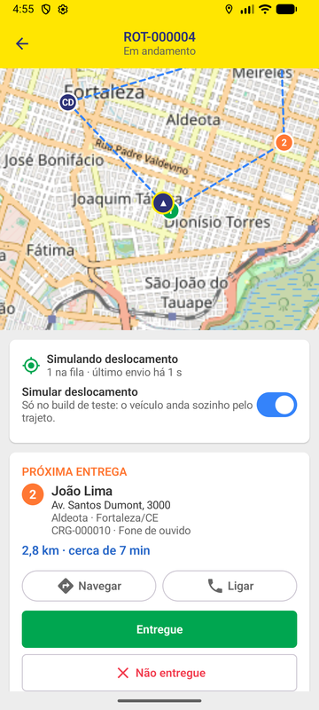
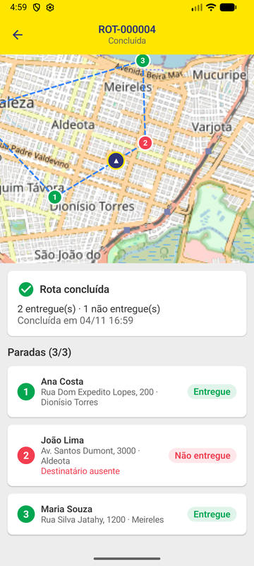
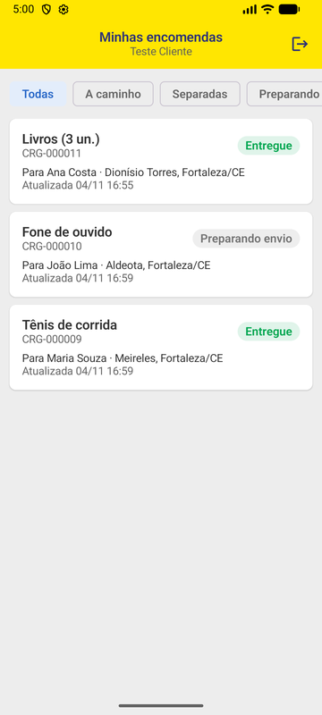
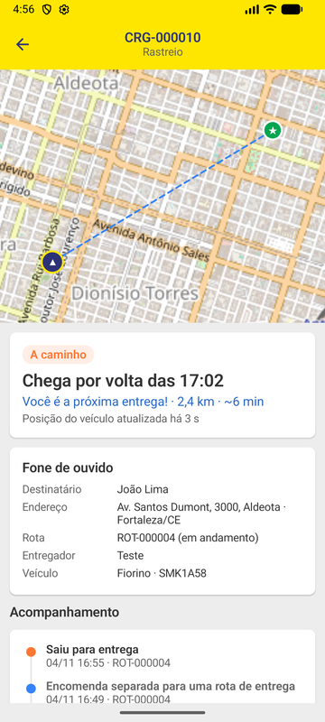
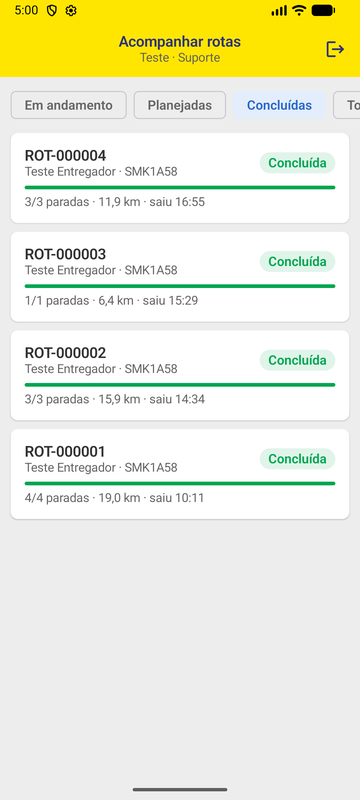
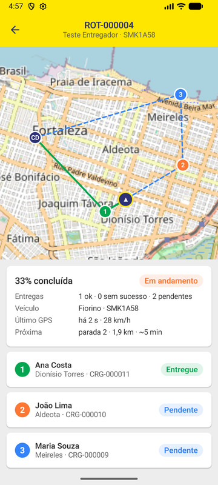

# RotaCerta — app Android (Kotlin)

App nativo do **RotaCerta**, o sistema de roteirização e rastreamento de entregas do MBA. Ele fala com a mesma API
do back-end ([spring_transportadora](https://github.com/ivens03/spring_transportadora)) e tem a mesma identidade
visual do painel web ([angular_transportadora](https://github.com/ivens03/angular_transportadora)).

Um app só, três módulos: a tela que abre depende do **perfil** de quem entrou (vem do token da API).

| Perfil | Como entra | O que faz no celular |
|---|---|---|
| **ENTREGADOR** | matrícula + PIN de 6 dígitos | vê as rotas dele, inicia a rota, navega até a próxima parada, liga para o destinatário, dá baixa (entregue / não entregue com motivo). Com a rota em andamento, o GPS é enviado mesmo com o app em segundo plano |
| **CLIENTE** | e-mail + senha (aba *Empresa*) | Portal do Cliente: lista as encomendas e acompanha cada uma no mapa, com previsão de chegada, "você é a próxima entrega" e linha do tempo |
| **SUPORTE** | e-mail + senha (aba *Empresa*) | acompanha as rotas ao vivo: mapa com o trajeto planejado, o rastro real do veículo, progresso e próxima parada |

Os outros perfis (Administrativo, Financeiro, Desenvolvimento) entram, mas veem só um aviso: o trabalho deles é no painel web.
O primeiro acesso (código de ativação) e a troca de PIN/senha vencida também funcionam pelo app.

## Telas

| Entrar | Rota planejada | Em andamento | Concluída |
|---|---|---|---|
|  |  |  |  |

| Cliente: encomendas | Cliente: rastreio | Suporte: rotas | Suporte: mapa ao vivo |
|---|---|---|---|
|  |  |  |  |

## Tecnologias

| | Versão | Para quê |
|---|---|---|
| Kotlin | 2.2.21 | linguagem |
| Android Gradle Plugin / Gradle | 8.13.0 / 8.13 | build |
| Jetpack Compose (BOM) + Material 3 | 2025.10.01 | interface declarativa |
| Navigation Compose | 2.9.5 | navegação com rotas tipadas (`@Serializable`) |
| Lifecycle (ViewModel, runtime-compose, service) | 2.9.4 | estado das telas e serviço com ciclo de vida |
| DataStore Preferences | 1.1.7 | guardar a sessão (token) |
| Coroutines | 1.10.2 | chamadas assíncronas sem travar a tela |
| Retrofit + OkHttp | 3.0.0 / 5.2.1 | cliente HTTP da API |
| kotlinx.serialization | 1.9.0 | JSON ⇄ classes Kotlin |
| osmdroid | 6.1.20 | mapa OpenStreetMap (sem chave de API) |
| JUnit 4 + MockWebServer + coroutines-test | | testes de unidade |

`minSdk 26` (Android 8.0), `targetSdk 36`.

## Como o app é organizado

Pacote **por módulo** (o mesmo padrão do back-end), com o que é compartilhado em `core/`:

```
br.com.mba.fametro.kotlintransportadora
├── RotaCertaApp.kt        Application: cria o AppContainer, configura o mapa e o canal de notificação
├── AppContainer.kt        "injeção de dependência" manual: sessão, API, fila de GPS
├── MainActivity.kt        a única Activity; tudo o mais é Compose
├── navegacao/             Destinos (rotas tipadas) e RaizApp (troca o NavHost conforme a sessão)
├── core/
│   ├── api/               Modelos (DTOs), RotaCertaApi (Retrofit), Rede (OkHttp + token), ApiErro
│   ├── sessao/            Sessao e SessaoRepository (login, DataStore, sair)
│   ├── geo/               Haversine e interpolação (a mesma conta do back)
│   ├── formato/           datas, km, minutos e rótulos em português
│   └── ui/                tema (paleta Mercado Livre), componentes e mapa (MapaOsm, MapaRota)
├── acesso/                entrar, primeiro acesso, trocar PIN/senha
├── entregador/            minhas rotas, execução da rota, RastreadorService, FilaGps, SimuladorGps
├── cliente/               encomendas e rastreio
└── suporte/               rotas para acompanhar e mapa ao vivo
```

### Conceitos (para quem vem do Spring)

- **Jetpack Compose**: a tela é uma função `@Composable` que recebe estado e desenha. Mudou o estado, o Compose
  redesenha só o que mudou (*recomposição*). Não há XML de layout.
- **ViewModel + estado**: cada tela tem um `ViewModel` (equivalente a um *controller* com estado) que sobrevive à
  rotação da tela. O estado fica em `mutableStateOf`/`StateFlow`; a tela só lê. As chamadas de rede rodam em
  `viewModelScope.launch { }` e são canceladas sozinhas quando o usuário sai da tela.
- **Corrotinas**: `suspend fun` é uma função que pode "pausar" sem bloquear a thread (como um `CompletableFuture`
  escrito de forma sequencial). O Retrofit gera as chamadas `suspend` a partir da interface `RotaCertaApi`, como um
  Feign client.
- **Injeção de dependência manual**: em vez de Hilt/Dagger, o `AppContainer` cria as dependências uma vez e as
  telas pegam o que precisam (`viewModelDe { container -> ... }`). Num app deste tamanho, isso basta e é mais fácil de ler.
- **Sessão**: o token JWT fica no DataStore (fora do backup do Android). O `AutorizacaoInterceptor` coloca o
  `Authorization: Bearer` em toda chamada; um **401** numa chamada autenticada encerra a sessão e volta para o login.
  O 403 `CREDENCIAL_EXPIRADA` leva direto para a troca de PIN/senha.
- **Rastreamento em segundo plano**: o Android mata apps em segundo plano, então o GPS roda num
  **foreground service** (`RastreadorService`, tipo `location`) com uma notificação fixa
  "Rota ROT-… em andamento". Ele usa o `LocationManager` do Android (sem Google Play Services) e:
  - filtra as leituras (`FiltroGps`): no mínimo 2 s **e** 15 m entre pontos, um "batimento" a cada 30 s parado, e
    descarta precisão pior que 100 m;
  - grava cada ponto numa **fila em arquivo** (`FilaGps`, um JSON por rota, gravação atômica) *antes* de enviar.
    Sem sinal, os pontos acumulam; quando a conexão volta, saem em lotes de até 500. O back-end ignora pontos
    repetidos, então reenviar é seguro;
  - para sozinho quando a rota é concluída ou cancelada, ou quando o entregador sai do app.
- **DNS com reserva** (`DnsComReserva`): algumas redes (a do DETRAN, por exemplo) bloqueiam o domínio do
  servidor respondendo um IP falso (`127.0.0.1`/`0.0.0.0`). Quando isso acontece, ou quando o DNS da rede falha,
  o app descobre o IP por **DNS-over-HTTPS** (Cloudflare, depois Google), que vai por HTTPS direto para o IP
  deles e passa por cima do filtro. O certificado do servidor continua sendo verificado: muda só a descoberta do IP.
- **Atualização automática**: a execução da rota recarrega a cada 15 s (a previsão até a próxima parada muda
  conforme o veículo anda), o rastreio do cliente também a cada 15 s, e o mapa do Suporte a cada 5 s, buscando só as
  posições novas (`GET /rotas/{id}/posicoes?desde=`).
- **Simulador de GPS**: só no build *debug* (`BuildConfig.SIMULADOR_GPS`). Com a chave "Simular deslocamento"
  ligada ao iniciar a rota, o veículo anda sozinho pelo trajeto (passos de 40 m) e para em cada parada até a baixa.
  No build *release* a chave nem aparece.

## Como rodar

Pré-requisitos: Android Studio (ou o SDK Android com `platform-tools` e `emulator`) e o **back-end rodando**
(`spring.transportadora`, perfil `dev`, porta 8085).

> **JDK 21 para o Gradle.** O Gradle 8.13 não roda em Java 25. No Android Studio isso já vem resolvido (ele usa o
> JDK embutido). No terminal:
> `export JAVA_HOME=/usr/lib/jvm/jdk-21.0.8-oracle-x64`

```bash
./gradlew assembleDebug          # gera app/build/outputs/apk/debug/app-debug.apk
./gradlew installDebug           # instala no emulador/celular conectado
./gradlew testDebugUnitTest      # testes de unidade
./gradlew lintDebug              # análise estática
```

### Endereço da API

Fica em `local.properties` (arquivo da máquina, fora do git), lido em tempo de build:

| Chave | Padrão | Quando mudar |
|---|---|---|
| `rotacerta.api.debug` | `http://10.0.2.2:8085/transportadora_dev/api/v1/` | `10.0.2.2` é o "localhost do computador" visto de dentro do emulador. Num celular de verdade, use o IP do computador na rede (ex.: `http://192.168.0.10:8085/...`) |
| `rotacerta.api.release` | `https://rotacerta.137-131-162-187.sslip.io/transportadora/api/v1/` | o servidor de demonstração (VPS com Dokploy, perfil `homolog`); troque pelo endereço HTTPS de outro servidor |

O build *debug* aceita HTTP sem TLS (`src/debug/res/xml/network_security_config.xml`); o *release* só aceita HTTPS.

**Celular sem cabo, usando o servidor de demonstração**: aponte o debug para a VPS e instale.
O simulador de GPS continua disponível:

```properties
rotacerta.api.debug=https://rotacerta.137-131-162-187.sslip.io/transportadora/api/v1/
```

**Atrás de proxy** (rede do trabalho): o mapa precisa baixar os tiles do OpenStreetMap. Suba o emulador pelo proxy e
mande a API pelo `adb reverse`:

```bash
emulator -avd Medium_Phone_API_36.1 -http-proxy http://127.0.0.1:3128
adb reverse tcp:8085 tcp:8085
# local.properties
rotacerta.api.debug=http://localhost:8085/transportadora_dev/api/v1/
```

Para o Gradle baixar as dependências pelo proxy, passe
`GRADLE_OPTS="-Dhttps.proxyHost=127.0.0.1 -Dhttps.proxyPort=3128 -Dhttp.proxyHost=127.0.0.1 -Dhttp.proxyPort=3128"`.

No emulador, a posição "real" do GPS é Mountain View (Califórnia). Para testar sem o simulador, mova-a para Fortaleza:
`adb emu geo fix -38.5005 -3.7400` (longitude, latitude).

### Contas de teste

São as contas fixas do perfil `dev` do back-end (dados no `.env` de lá):

| Perfil | Login |
|---|---|
| Entregador | matrícula `ENT-TESTE-01` + o PIN de `ROTACERTA_TESTE_ENTREGADOR_PIN` |
| Cliente | `cliente.teste@rotacerta.local` + `ROTACERTA_TESTE_CLIENTE_SENHA` |
| Suporte | `suporte.teste@rotacerta.local` + `ROTACERTA_TESTE_SUPORTE_SENHA` |

Para ver o Portal do Cliente funcionando, cadastre cargas com `clienteMatricula = CLI-TESTE-01` e monte uma rota
com elas para o `ENT-TESTE-01` (pelo painel web ou pela API).

## Testes

Testes de unidade (JVM, sem emulador) em `app/src/test`:

| Classe | O que garante |
|---|---|
| `GeoTest` | distância Haversine e interpolação do simulador |
| `FiltroGpsTest` | intervalo mínimo, distância mínima, batimento parado, precisão ruim e o arredondamento que o back aceita |
| `FilaGpsTest` | lote, confirmação parcial, fila que sobrevive ao app fechar, limite de tamanho, limpeza do arquivo |
| `ApiErroTest` | tradução do `ErroResponse` do back, credencial expirada, sem conexão, cancelamento de corrotina não engolido |
| `DnsComReservaTest` | DNS da rede quando responde certo; reserva quando ele falha ou devolve 127.0.0.1/0.0.0.0; `localhost` do emulador continua valendo |
| `AutorizacaoInterceptorTest` (MockWebServer) | Bearer só nas chamadas autenticadas; 401 encerra a sessão, mas 401 do login não |

Os fluxos completos (entregador do início ao fim da rota, Portal do Cliente e mapa do Suporte) foram validados no
emulador contra a API local.

## Permissões

| Permissão | Por quê |
|---|---|
| `INTERNET`, `ACCESS_NETWORK_STATE` | API e tiles do mapa |
| `ACCESS_FINE_LOCATION`, `ACCESS_COARSE_LOCATION` | GPS do entregador (pedida só ao iniciar a rota) |
| `FOREGROUND_SERVICE`, `FOREGROUND_SERVICE_LOCATION` | rastrear com o app em segundo plano |
| `POST_NOTIFICATIONS` | a notificação fixa do rastreamento (Android 13+) |

A localização em segundo plano (`ACCESS_BACKGROUND_LOCATION`) **não** é necessária: o serviço começa com o app
aberto, e um foreground service iniciado assim continua recebendo o GPS.
